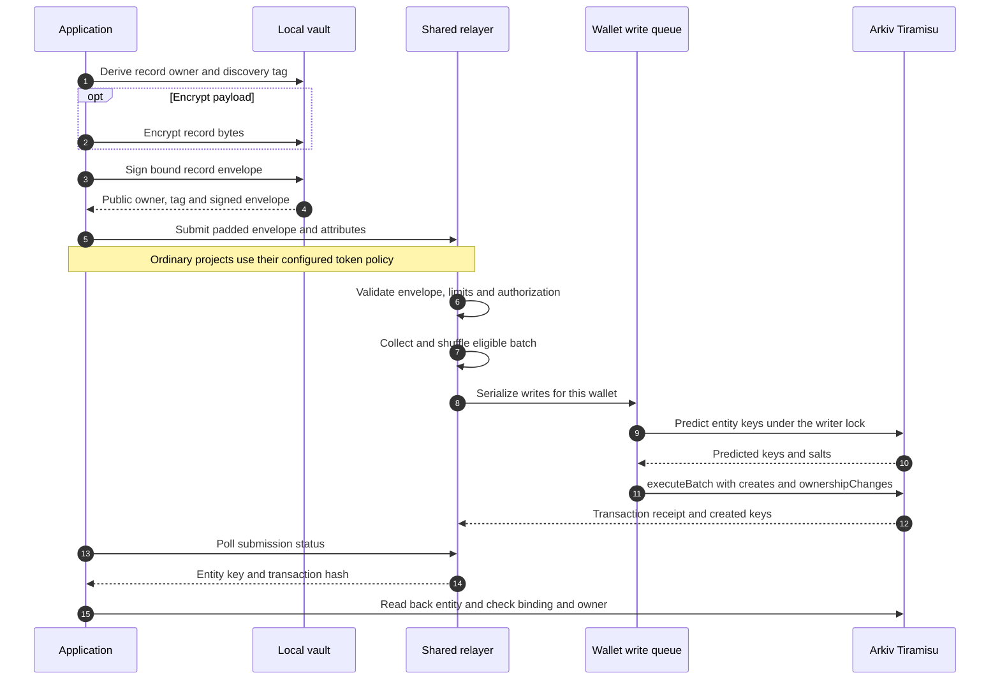
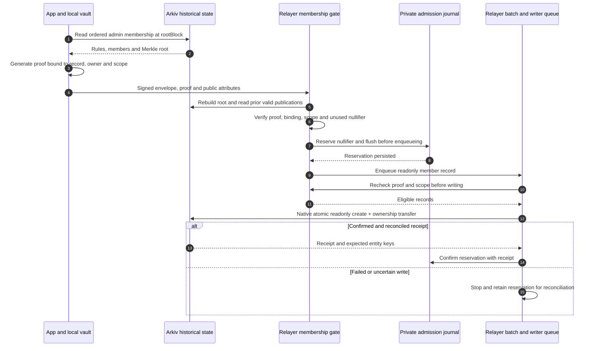
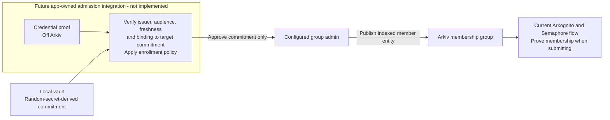

# Arkognito architecture and trust boundaries

Arkognito is the project and published TypeScript package (`arkognito`). It wraps Arkiv's native
entity operations with local key management, separate record owners, shared relaying, encrypted
discovery and optional anonymous group authorization. This describes the current implementation,
not a production anonymity guarantee. Use synthetic data only under this project's rules.

[README](../README.md) · [Semaphore integration](semaphore.md) · [Protocol](../spec/SPEC.md) ·
[Arkiv schema](../arkiv/schema.md) · [Recorded validation](semaphore-validation.md)

## Ordinary record writes

The default owner derivation gives a record a fresh address. An explicitly shared owner scope can
reuse an address and deliberately link records. The relayer is the public creator and pays for the
native transaction; ownership is transferred in that same transaction.

An encrypted record still exposes its attributes, envelope structure, owner, creator, size bucket
and publication timing. An unencrypted payload is public. The shared creator hides the user's main
wallet from that field; it does not hide the relayer or remove transaction history.

Implementation: [`createPrivateClient`](../packages/sdk/src/client.ts),
[`Batcher`](../packages/relayer/src/batcher.ts),
[`WriteQueue`](../packages/relayer/src/arkiv.ts).

## Recovery and private discovery

`myEntities()` fetches shared relayer listings and tries encrypted discovery tags locally, rather
than querying the RPC with a list of the user's derived owners. Larger listings use relevant
batches and cover batches. This reduces an owner-set disclosure; a provider can still observe
requests, timings and access patterns. Discovery and decryption require the user's private vault.

`proveOwnership()` signs a verifier-issued challenge with a record's owner key. It proves control of
that owner; it is separate from anonymous membership. The verifier must use a fresh challenge and
decide how to retain any proof it receives.

| Location | Data | Trust boundary |
| --- | --- | --- |
| Local vault / browser key worker | Root secret, derived keys, recovery operations, membership identity | Keep recovery material private; a hostile frontend can request operations and observe plaintext |
| Relayer | Submitted envelope, public owner, attributes, proof if enabled, request timing | Encryption protects encrypted bytes; ordinary direct requests expose the connecting IP |
| Local admission journal | Scoped nullifier reservations and confirmed submission receipts | Persist privately; one-host coordination, no cross-host consensus |
| Arkiv | Public attributes, envelopes, owners, creators and transaction history | Payload confidentiality requires encryption; deleting live state does not erase history |
| Group admin | Admission decisions and submitted public commitments | Controls who may enroll; admission mappings must stay off Arkiv |
| Reader / RPC provider | Public data used to verify a feed | Historical availability and completeness remain provider dependencies |

Optional OHTTP inserts an independently operated relay before the application relayer. Its privacy
assumption is non-collusion between operators. It does not automatically hide the client's separate
Arkiv RPC reads or defend against every timing observer.

## Semaphore-gated writes

An admin publishes readonly group rules and readonly member commitments in a stable index order.
The local vault derives a group-specific identity from its private root. The app obtains a pinned
membership snapshot, then asks the vault to prove membership with a message bound to the record.
No main-wallet signature is required when using a random/recovery vault.

A configured project's valid membership proof replaces blind-token redemption. It does not bypass
the project gate when tokens are disabled. Scope is fixed per poll or derived from block windows,
not wall-clock hours. One accepted submission per enrolled identity and scope is not a guarantee
of one submission per human.

The record binding covers typed app attributes, encrypted or plain bytes, discovery tag, encryption
mode, app, owner, expiry, group, chain, scope and root block. The relayer cannot substitute a new
owner or message and retain a valid binding. It can still withhold service or delay a submission.
Membership batches need real valid submissions to meet their minimum size; forged proof-bearing
cover records are not available.

The journal retains reservations when the result is uncertain. A stale lock, corrupted journal or
missing historical data stops admission. Operators must reconcile before retrying or repairing;
clearing the journal is not a recovery procedure. Separate journals can admit concurrent duplicates,
so readers independently apply the canonical earliest-valid rule.

Implementation: [`SemaphoreGate` and `FileAdmissionJournal`](../packages/relayer/src/semaphore.ts),
[membership primitives](../packages/sdk/src/semaphore.ts),
[historical reader](../packages/sdk/src/semaphore-arkiv.ts).

## Independent verification

Readers authenticate native creation logs and successful receipts from their explicitly trusted
relayer creators. They load publications at creation, check readonly flags and owner signatures,
rebuild each proof's admin group at `rootBlock`, and verify the proof and full record binding.

The canonical winner is the earliest **valid** publication for a group/scope/nullifier, ordered by
block number, transaction index and log index. An earlier fake proof does not consume a nullifier.
A valid winner that later disappears from live state remains spent; a later duplicate never
replaces it. `accepted` contains live winners, `rejected` reports invalid/duplicate publications,
and `spent` retains canonical nullifier use, including vanished winners.

An unavailable or incomplete historical read throws `VerificationUnavailable`. Applications must
show verification as unavailable rather than presenting an empty verified feed. This design needs
bounded history scans today; long-lived deployments need a durable authenticated index. It does
not cryptographically prove that the RPC returned every log.

## Credential admission is an application integration

Semaphore answers “is this submission from an enrolled member?” It does not decide who deserves
membership. Anon Aadhaar or another credential system would provide evidence to an application's
admission service, which verifies it independently before its admin adds a random-secret-derived
commitment. Only the separate synthetic Anon Aadhaar experiment has been tested; the end-to-end
adapter below is **future work**.

Real credential material, credential proofs, credential-derived hashes/nullifiers and private
admission mappings stay off Arkiv under this project's rules. The app must handle repeated
enrollment, issuer trust and credential freshness; Semaphore does not supply those policies.

## Current limits and evidence

- Tiramisu testnet; no independent security audit or complete anonymity guarantee.
- Append-only membership; revocation requires group/policy rotation, and old roots remain usable
  within the configured age window.
- Readonly means payload/attribute updates are blocked. Owners can still transfer, delete or extend
  entities where permitted; expiry is not historical erasure.
- One process per wallet, persistent private journals, finite verification budgets and manual
  reconciliation for uncertain membership writes.
- Browser-worker proving was exercised on desktop headless Chrome. Physical passkey and mobile
  membership compatibility still need device testing.

For actual counts, timings and remaining warnings, read [integration evidence](semaphore-validation.md)
and [the published 0.1.0 release checks](release-0.1.0.md). These diagrams add documentation; they do
not represent a new testnet run or a new npm version.
